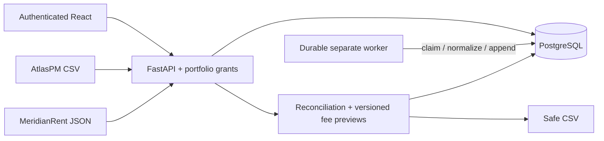

# PortfolioLedger

A working property-finance operations demonstration: normalize incompatible landlord feeds, preserve financial history, reconcile source discrepancies and produce repeatable monthly administration-fee previews.

**Independent synthetic-data project.** Two fictional landlords and two invented provider formats. No relationship, integration, endorsement, customer usage or proprietary knowledge of LeaseSurance, Octoco, MRI, Xero, Guardrisk or any real property-management provider is claimed. No actual invoices, payments, coverage or insurance decisions are created.

## What works

- Authenticated React application with admin, scoped analyst and read-only reviewer access.
- AtlasPM CSV snapshots and MeridianRent JSON incremental events, deterministic bundled fixtures and actual upload/replay.
- Durable separate PostgreSQL worker: leased claims, skip-locked polling, bounded retries and crash recovery.
- Per-row validation/quarantine, stable source hashes, import receipts, conflicting idempotency-key rejection and duplicate handling.
- Append-only Decimal rental ledger, explicit revision reversal/replacement, source evidence and historical lease versions.
- Persisted monthly reconciliation with expected/actual evidence and audited human review.
- Immutable administration-fee previews by portfolio/month/cutoff/pricing version, included/excluded lease lines and downloadable safe CSV.
- Database-derived operational health, audit timeline, readiness, mobile layout and persisted reload behavior.

Local verification includes PostgreSQL invariant/API tests, real Chrome journey/mobile tests and an isolated **10,000-event import plus replay**. Measured baseline: 100.59s initial, 80.81s replay; 10,000 ledger postings retained after replay. See [actual results and failures](docs/validation.md), not just a feature list. No public deployment is claimed.

## Release/UI candidate

Current branch refreshes every screen with a neutral white design system and adds a canonical source registry, password-free read-only reviewer, fail-closed production configuration, separate runtime grants and a real local backup/restore drill. See [current validation](docs/validation.md), [before/after UI evidence](docs/iterations/005-design-system-and-navigation.md) and [release gates](docs/deployment.md). The original local evidence above remains historical; public deployment is **NO-GO** until hosted gates are verified.

Uploads now select enabled configured source identities. Additive migration b003 retains historical keys disabled until reviewed; explicit synthetic seed enables the two known fictional demo sources. A new source key cannot create another ledger namespace through the API.

## Quick start — Docker

Requires running Docker Desktop / Docker Compose. From this repository root:

```sh
python3 scripts/init_env.py
docker compose up --build -d
```

The first command creates a private `.env` with a random demo password. If `.env` already exists, it is left unchanged. Set a private DEMO_PASSWORD of at least 12 characters when configuring manually. Do not commit `.env`.

Open [local application](http://localhost:5173). API [Swagger](http://localhost:8000/docs), [readiness](http://localhost:8000/ready). Local PostgreSQL: localhost:5438. All exposed Compose ports bind to loopback.

| Demo login | Access |
|---|---|
| admin@portfolioledger.test | Both portfolios, supported writes |
| analyst@portfolioledger.test | Cedarstone Living only, supported writes |
| reviewer@portfolioledger.test | Both portfolios, read only |

Password: the private **DEMO_PASSWORD value in your local `.env`**. Open that file locally in your editor. No shared public password is shipped. Existing user passwords are not rotated by repeat seeding.

A separate one-off release service migrates the database and explicitly seeds deterministic synthetic fixtures. Ordinary API boot never migrates. Select **November 2026 (`2026-11`)** for the anchored reviewer scenarios. Atlas includes unmatched/malformed rows; Meridian includes correction and stale revision. `recovery.csv` records a real injected failed attempt and successful recovery (attempt two) without additional postings.

```sh
docker compose ps
docker compose logs --tail=50 api worker
docker compose down
# Restart, preserving the named PostgreSQL volume:
docker compose up -d
```

Do not add `-v` when stopping unless intentionally deleting this synthetic database.

## Development and verification

Requires Python 3.12+, Node 24, npm, PostgreSQL 16+ (Compose supplies it) and installed Chrome for browser tests.

```sh
make setup
# If .env does not yet exist:
python3 scripts/init_env.py
docker compose up -d db
make migrate
make seed
```

Run in three terminals (stop Compose api/worker/web first if they occupy the same ports):

```sh
make dev-api
make worker
make dev-web
```

Then:

```sh
make check       # Ruff, formatting, strict mypy, frontend format/type/build
make test        # PostgreSQL schemas migrated from blank, API/invariant tests
make acceptance  # isolated HTTP journey + measured 10k financial events/replay
make e2e         # real Chrome; API, worker and web must be running
```

`make e2e` reads the private password from `.env` or environment. To install the CI browser: `cd frontend && npx playwright install --with-deps chrome`. Browser traces can contain typed credentials; they are gitignored and never uploaded by CI. Test schemas are temporary; use a dedicated test database if working with any shared environment. No SQLite substitute is used.

## Architecture and financial rules

Python 3.12, FastAPI/Pydantic v2, synchronous SQLAlchemy 2.x, psycopg 3, PostgreSQL 16, Alembic; React 19, strict TypeScript and Vite; pytest/cov, Ruff, strict mypy, Playwright, Docker Compose and GitHub Actions workflow.



Rental ledger and administration fees are separate. Charges increase receivable; payments/credits decrease it; corrections reverse then replace. All monetary calculations use Decimal/NUMERIC(18,2), ROUND_HALF_UP. Timestamps UTC, financial dates calendar dates, Johannesburg boundaries. Fee v1: ZAR 85.00 per lease active on month start; end date inclusive, no proration. Source publication cutoff and pricing version identify reproducible immutable results. A resolution records rationale, never posts money.

## One-minute engineering review

Replay a batch under Integrations and inspect duplicate counts without an increased ledger balance. Open a ledger event's source evidence and trace Meridian's reversal/replacement. Run November reconciliation, inspect expected/actual/source IDs and resolve with rationale; find the actor/action in Audit. Calculate a fee preview twice with the same cutoff, inspect line eligibility and download CSV. Reload to verify persistence. Inspect recovery.csv attempts and the journal's actual failed-to-passing regression history.

Longer [60–90-second walkthrough](docs/reviewer-walkthrough.md) and [application description](docs/project-description.md).

## Engineering evidence and documentation

- [Evidence index](docs/evidence-index.md), [chronological journal](docs/engineering-journal.md), [iterations](docs/iterations), [defect log](docs/defects.md), [changelog](CHANGELOG.md).
- [Architecture/schema/migrations](docs/architecture.md), [decisions](docs/adr), [domain rules/provider mapping](docs/domain-rules.md), [API/authentication](docs/api.md).
- [Validation measurements](docs/validation.md), [verification commands](docs/verification.md), [operations/recovery](docs/operations.md), [security/threat model](docs/security.md).
- [Deployment preparation/blockers](docs/deployment.md), [tradeoffs/priorities](docs/tradeoffs.md), [general property-engineering relevance](docs/leasehub-relevance.md).

GitHub Actions configuration is included; hosted CI success is not claimed unless a run is actually inspected. Public writable reviewer isolation/reset, cloud deployment, telemetry, scheduled imports, S3 and claims tracking remain out of scope. Optional public review uses read-only sessions and existing evidence/CSV; see deployment instructions for the local test workflow. See security notes before any public hosting.
