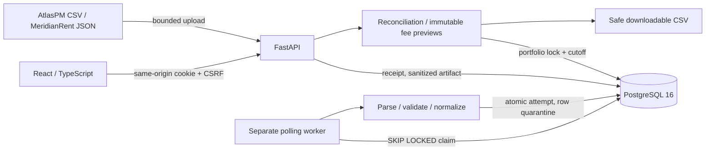

# Architecture

PortfolioLedger is a synchronous modular monolith with an independent durable worker. All displayed operational facts come from PostgreSQL. Synthetic files are input examples, not mocked responses.

Core boundaries: `integrations` translates fictional provider formats; `domain` defines money/date/eligibility behavior; `services` owns locking and transactions; API performs authorization and request validation; worker claims durable jobs. SQLAlchemy is synchronous throughout. PostgreSQL NUMERIC(18,2) and Python Decimal handle financial values. JavaScript Number is used for **display formatting only**, never business calculations.

## Relational summary

- users, sessions, portfolio_access: identity and explicit grants.
- portfolios, units, tenants, leases: fictional scoped business identities.
- lease_versions: immutable source-backed normalized terms, revisioned per lease.
- pricing_versions: immutable effective-dated service-fee settings.
- import_jobs: durable artifact/checksum/receipt, processing lease, counts/attempts.
- raw_records: sanitized allowlisted original fields, row hash/status/reason.
- ledger_entries: signed postings, reverses_id lineage, source/revision uniqueness.
- reconciliations, exceptions: algorithm/cutoff/input batch evidence and review state.
- billing_previews, billing_preview_lines: immutable pricing, totals, inclusions/exclusions.
- audit_events: append-only business actions with actor/correlation/details.
- rate_windows: database-backed fixed-window request budgets.

UUIDs are stored as bounded strings; composite foreign keys enforce portfolio ownership for source/lease/ledger/preview lineage. Source identity is `(portfolio, source_key, external_id)`; keep source keys stable. One configured adapter per portfolio is intentionally embedded in the portfolio model. No speculative integration-settings service or external provider connection exists.

## Schema evolution

Alembic revision `aacf7692e44e` creates the initial schema; `b001` adds database immutability triggers; `b002` hardens pricing ownership, event uniqueness and state/revision checks. Future changes add revisions; never modify applied migration history. Tests create unique temporary schemas and run the actual migration chain. No application `create_all()` exists. Down migrations are for disposable test/development databases, not financial-data erasure. Run migrations as a release step before new workers/API start.

## Transaction and snapshot boundaries

See [ADR-001](adr/001-postgresql-transactions.md), [ADR-002](adr/002-ingestion-publication.md) and [ADR-003](adr/003-reproducible-cutoffs.md). A worker attempt publishes accepted rows and quarantine outcomes in one transaction. Financial snapshots use completed import cutoffs and immutable lease versions. Portfolio finance locks serialize imports and snapshot generation. Repeated identical preview coordinates return the same persisted UUID. The API commits function-scoped dependencies before returning success.
